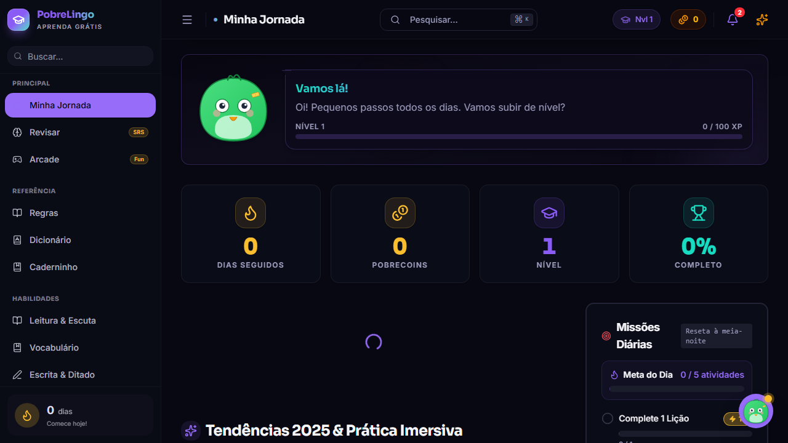
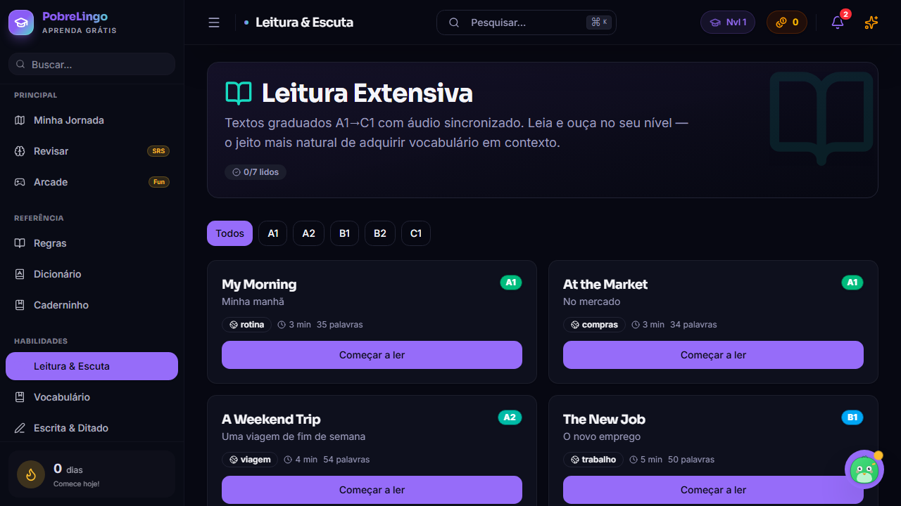
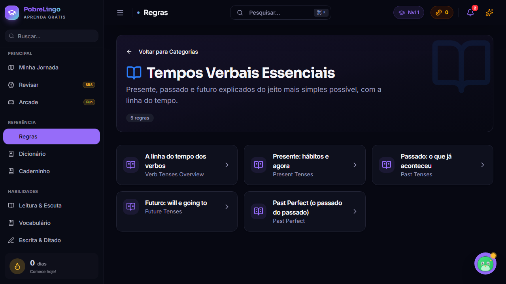
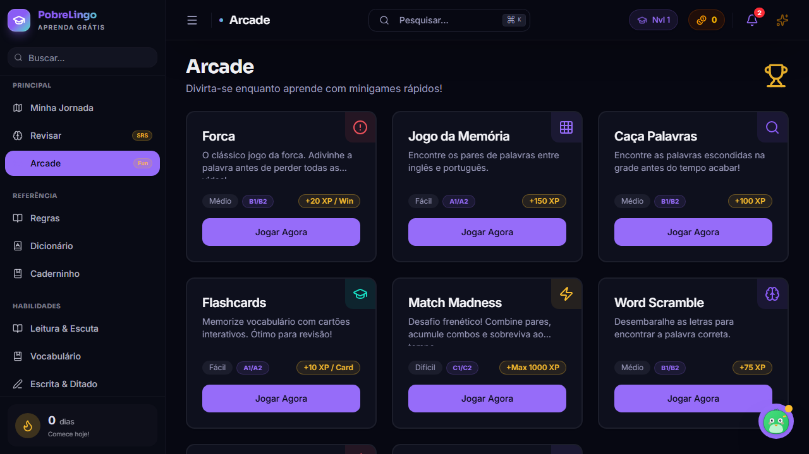
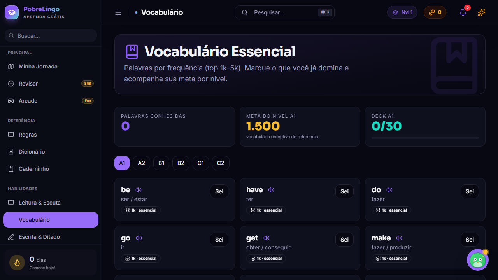
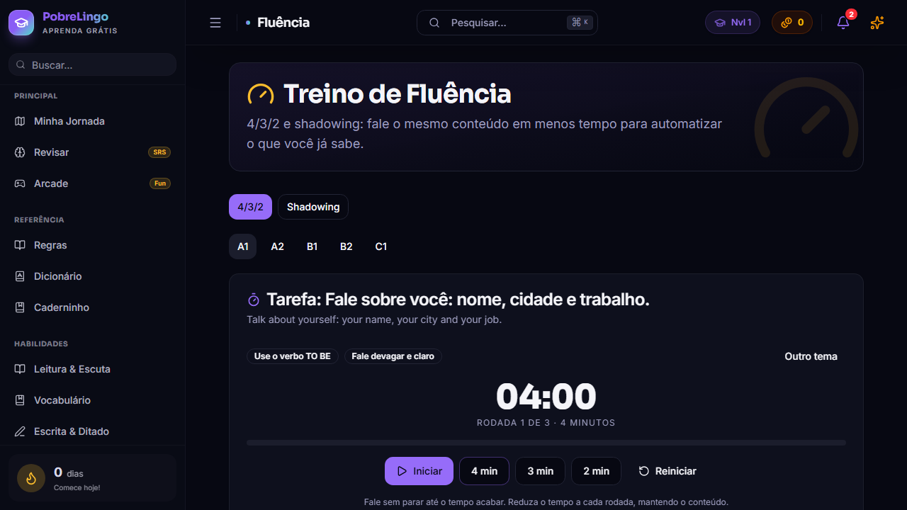
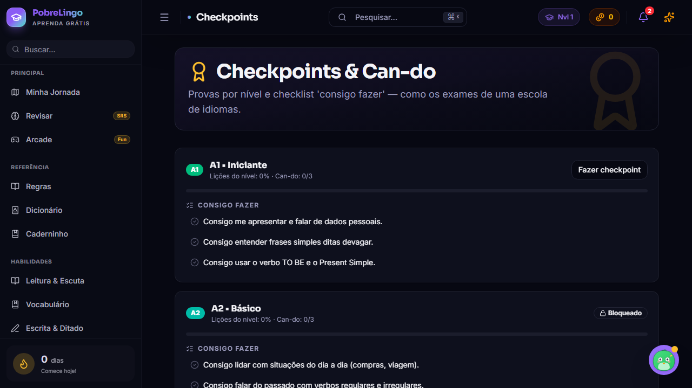
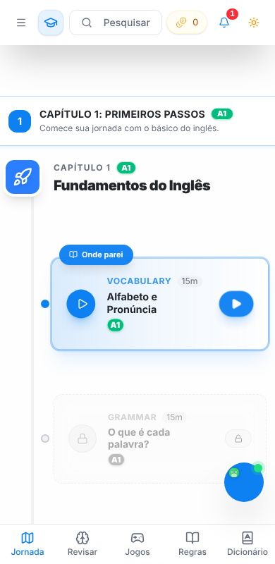

<div align="center">


# PobreLingo

### Inglês do zero ao C2 — grátis, em português, direto no navegador.

<p>
  
  
  
  
</p>
<p>
  
  
  
  
  
</p>



</div>

---

## 💡 Por que existe

Aprender inglês não deveria custar uma assinatura. O **PobreLingo** é um app de estudo completo, feito para quem **nunca viu gramática**: explicações em português, exemplos traduzidos, áudio em cada frase e uma trilha clara do **A1 ao C2** — sem paywall, sem anúncio, sem login obrigatório.

O desenho pedagógico segue evidência, não moda:

| Princípio | Onde aparece no app |
|---|---|
| **As 4 vertentes de Nation** — input, output, fluência e foco na forma | Leitura, Escrita, Fluência e Regras |
| **CEFR / can-do** | Trilha da Fluência e Checkpoints por nível |
| **Repetição espaçada (SRS)** | Revisar e Cofre de Vocabulário |
| **Carga cognitiva baixa** | Design system Aurora: tokens consistentes, chunking, hierarquia |
| **Gamificação integrada** | XP, streak, PobreCoins, missões diárias e conquistas |

---

## ✨ O que tem dentro

<table>
<tr>
<td width="50%" valign="top">

### 🗺️ Trilha da Fluência
15 capítulos mapeados em **A1 → C2**, com progresso por nível, marcador “Onde parei” e **nivelamento adaptativo** (banco de 72 questões) que já indica a lição por onde começar.

### 📚 Gramática para leigos
**57 regras em 16 categorias** — do verbo TO BE à voz passiva — com estrutura, exemplos traduzidos, áudio e erros comuns.

### 📖 Leitura & Escuta
**60 textos graduados A1–C2** com TTS sincronizado, play contínuo e tradução por linha.

</td>
<td width="50%" valign="top">

### 🧠 Vocabulário
**~2.700 palavras** por frequência (1k–5k), busca, metas por nível e revisão espaçada com **FSRS** — o mesmo algoritmo do Anki.

### ✍️ Escrita & 🗣️ Fluência
Ditado com diff palavra a palavra, redação com **correção por IA local**, técnica **4/3/2** cronometrada e *shadowing*.

### 🏁 Checkpoints
Checklist can-do + prova por nível: passou, libera o próximo.

</td>
</tr>
</table>

### 🤖 Tutor de conversa com IA — sem chave, sem servidor

Converse em situações reais (hotel, aeroporto, restaurante, entrevista, reunião) com uma IA que **roda no seu aparelho**: a IA embutida do Chrome (Gemini Nano) ou, sem ela, um modelo aberto (Qwen2.5) via WebGPU. Fale ou digite; a IA responde no papel e corrige seus erros em português.

### 🗣️ Pronúncia para brasileiros

TH, *ship/sheep*, schwa, -ed, o “i” a mais em *clubi*, H vs R e tonicidade: primeiro você **ouve e discrimina** pares mínimos, depois **produz** e o app confere o que foi reconhecido.

### 🧭 Trilhas por objetivo

**Viagem** e **Trabalho**: lições, leituras, conversas guiadas e simulações com o tutor numa sequência só.

### 🎮 Arcade

Oito jogos para fixar sem perceber: **Bubble Pop · Speed Match · Memory Match · Word Scramble · Flashcards · Word Search · Sentence Rush · Hangman** — mais sete tipos de exercício (listening, conversação, ordenar frases, pares, notícias, achar o erro, identificar frases).

---

## 📸 Telas

<div align="center">

| Leitura extensiva | Tempos verbais |
|:---:|:---:|
|  |  |
| **Arcade** | **Cofre de Vocabulário** |
|  |  |
| **Fluência 4/3/2** | **Checkpoints** |
|  |  |



<sub>Mobile-first de verdade: auditado sem overflow horizontal em 41 rotas.</sub>

</div>

---

## 🚀 Rodando localmente

> Requer **Node.js 20.19+** (exigência do Vite 8).

```bash
git clone git@github.com:juninmd/pobre-lingo.git
cd pobre-lingo
pnpm install          # ou: npm install
pnpm dev              # http://localhost:5173
```

| Comando | O que faz |
|---|---|
| `pnpm dev` | servidor de desenvolvimento com HMR |
| `pnpm build` | `tsc` + build de produção em `dist/` |
| `pnpm preview` | serve o build localmente |
| `pnpm lint` | Biome em `src/` |
| `pnpm test:run` | testes unitários (Vitest) |
| `npx playwright test` | suíte E2E completa, desktop + mobile |

---

## 🏗️ Arquitetura

```text
src/
├── pages/        # uma rota = uma página (lazy)
├── components/   # UI por feature + primitives shadcn/Radix
├── hooks/        # usePersistentState, useKnownWords, useCanDo…
├── contexts/     # tema, progresso, gamificação
├── lib/          # conteúdo e lógica pura
│   ├── curriculumData.ts      # capítulos → módulos → lições
│   ├── grammar*.ts            # 57 regras em 16 categorias
│   ├── readers/ · vocab/      # 60 leitores e ~2.700 palavras A1–C2
│   ├── srs*.ts · levels.ts    # repetição espaçada (FSRS) e níveis CEFR
│   ├── ai/                    # tutor: IA do Chrome ou WebLLM, prompts
│   ├── placement/             # nivelamento adaptativo
│   ├── pronunciation/         # pares mínimos e tonicidade
│   └── tts.ts                 # Web Speech API
└── Router.tsx    # 40 rotas
tests-e2e/        # Playwright: auditoria de todas as telas + fluxos
```

- **100% client-side**: progresso em `localStorage`, áudio via Web Speech API, IA no próprio aparelho — nada de servidor, conta ou chave.
- **Seus dados, seu controle**: exporte e restaure o progresso em Configurações; gravação de sessão (LogRocket) só com consentimento explícito.
- **Conteúdo como dados**: adicionar uma regra, leitura ou lição é editar um arquivo em `src/lib/` (veja [`docs/curriculum-system.md`](docs/curriculum-system.md)).
- **Arquivos pequenos**: limite de 150 linhas por arquivo, separação de responsabilidades por feature.

### 🎨 Design system “Aurora”

Obsidian ink + violeta + aqua + ouro solar, tipografia **Sora** (títulos) + **Inter** (texto), três temas, tudo via tokens em `globals.css` e `tailwind.config.ts`.

---

## 🧪 Qualidade

- **284 testes E2E** (contra o build de produção) — auditoria de 41 rotas em desktop **e** mobile (erro de JS, overflow horizontal, print de cada tela) + fluxos de estudo.
- **73 testes unitários** — FSRS, validação de fala, backup, nivelamento adaptativo, trilhas, prompts da IA.
- **Integridade de conteúdo** — toda lição de gramática precisa resolver uma regra existente; o teste falha se um link quebrar.

---

## 🛣️ Roadmap

Veja [`ROADMAP.md`](ROADMAP.md). Análise de concorrentes e lacunas em [`docs/benchmark-2026-09.md`](docs/benchmark-2026-09.md). Próximos passos: condicionais separados (zero → third), exercícios dedicados por regra e revisão nativa das traduções do vocabulário.

## 🤝 Contribuindo

1. Crie uma branch a partir de `master`.
2. Mantenha arquivos com até 150 linhas e use os tokens do design system.
3. Rode `pnpm lint`, `pnpm build`, `pnpm test:run` e `npx playwright test` antes do PR.

<div align="center">

---

<sub>Feito com ☕ para quem quer aprender inglês sem gastar nada.</sub>

</div>
