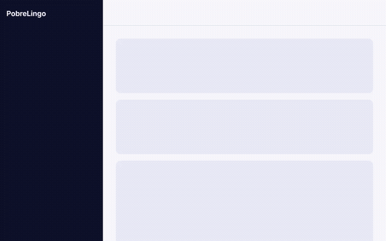
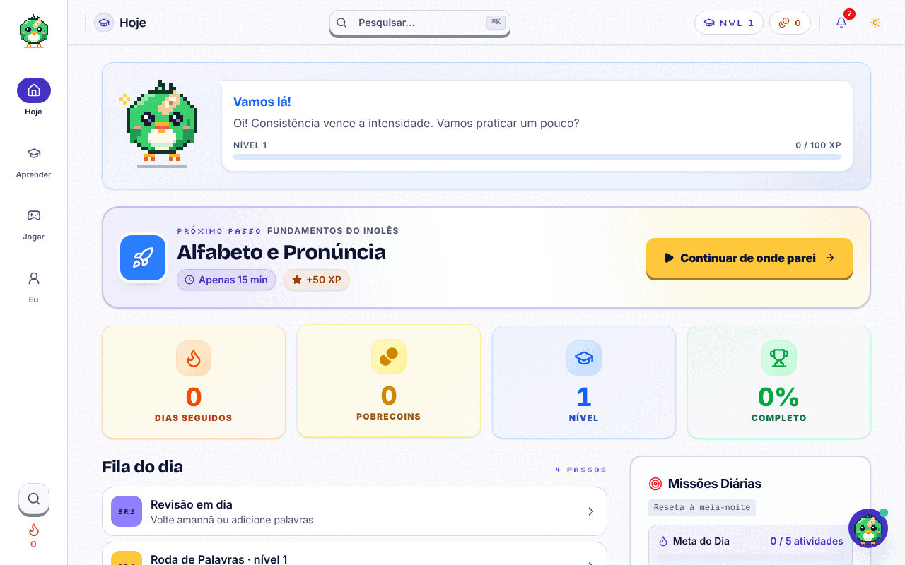
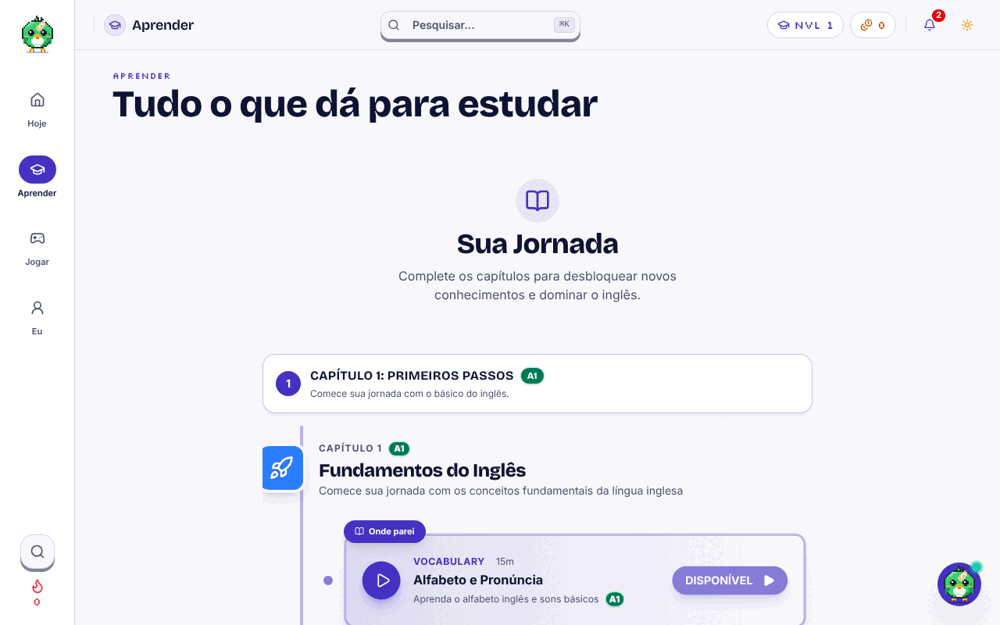
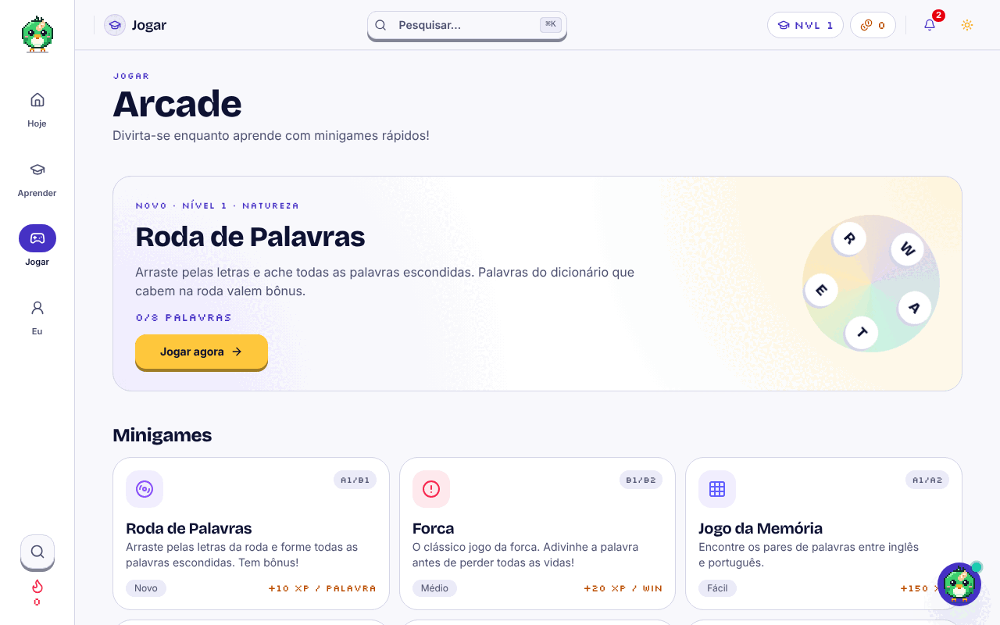
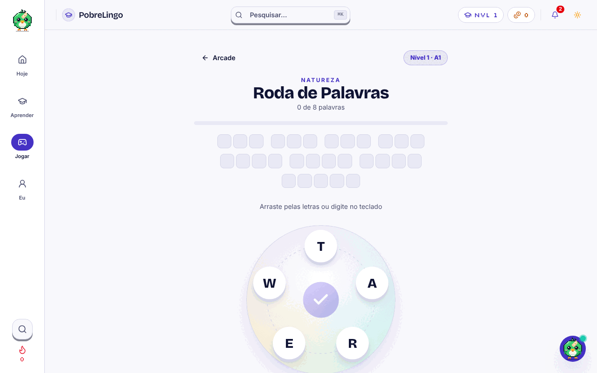
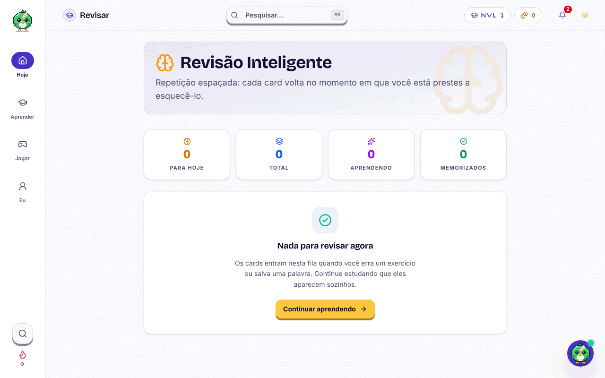
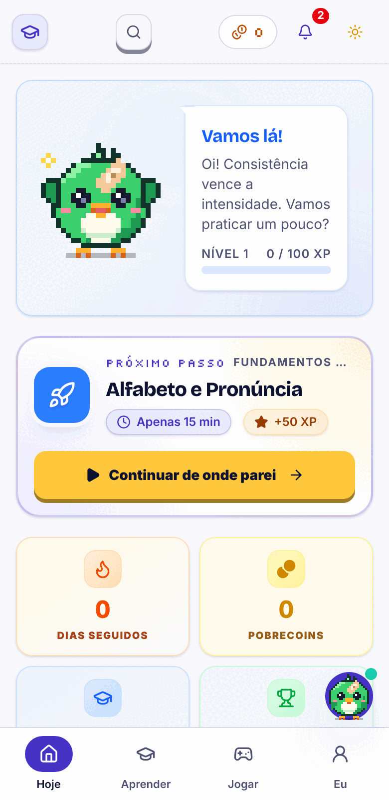
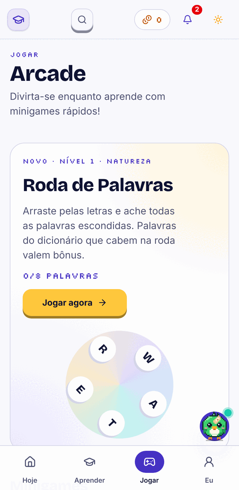
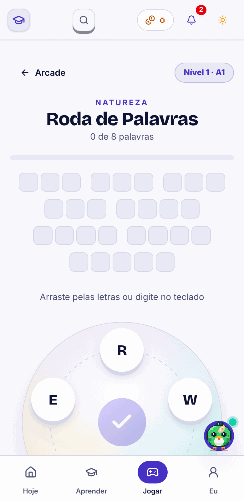
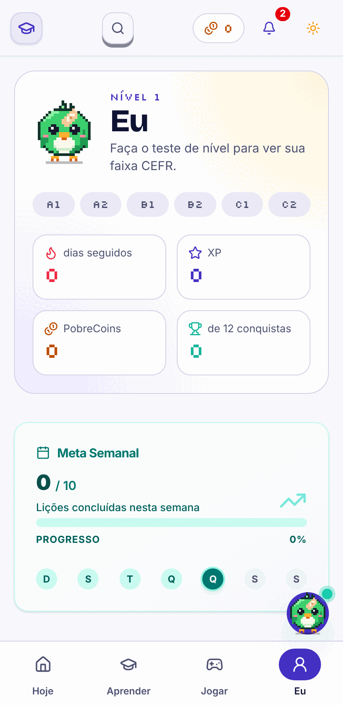

<div align="center">


# Pobre Lingo

**Aprenda inglês de graça, no bolso. Um arcade de bolso em pt-BR.**

[](https://juninmd.github.io/pobre-lingo/)




</div>

PWA de inglês com interface em português: regras de gramática, exercícios, jogos, dicionário, revisão espaçada e painel de progresso. **Local-first**: todo o progresso fica no `localStorage` e funciona offline. Sincronização na nuvem é opcional e sem conta (um código secreto identifica seus dados).

## ✨ Destaques

| | |
|---|---|
| 🧭 **Quatro abas** | Hoje, Aprender, Jogar e Eu. Barra inferior no celular, trilho lateral no desktop, busca com <kbd>Ctrl</kbd>/<kbd>⌘</kbd>+<kbd>K</kbd>. |
| 🎡 **Roda de Palavras** | Arraste pelas letras e ache todas as palavras do tema. |
| 🐦 **Mika** | Personagem VRM 3D que puxa assunto e corrige seu texto ao vivo. |
| 🧠 **Revisão espaçada** | Cartões agendados com FSRS. |
| 🤖 **Tutor de IA no navegador** | Prompt API do Chrome ou WebLLM (WebGPU). Nada de chave no cliente. |
| 📴 **Offline e instalável** | PWA com service worker. |

## 📸 Telas

<table>
<tr>
<td align="center"><b>Hoje</b><br/></td>
<td align="center"><b>Aprender</b><br/></td>
</tr>
<tr>
<td align="center"><b>Jogar</b><br/></td>
<td align="center"><b>Roda de Palavras</b><br/></td>
</tr>
<tr>
<td align="center"><b>Conversa com a Mika</b><br/></td>
<td align="center"><b>Revisão</b><br/></td>
</tr>
</table>

### 📱 No celular

<p align="center">





</p>

## 🚀 Início rápido

Requisitos: Node 22.22+ e pnpm (`pnpm@8.14.3`).

```bash
pnpm install
pnpm dev
```

```bash
pnpm check        # typecheck + lint + testes
pnpm build        # dist/
pnpm exec playwright test   # e2e
```

## 🧱 Stack

React 19 · React Router 7 · Vite 8 · TypeScript 7 · Tailwind 4 · Radix UI · ts-fsrs · WebLLM · three + `@pixiv/three-vrm` · Biome · Vitest · Playwright.

## 📚 Documentação

- [Guia de desenvolvimento](docs/development.md): scripts, layout, convenções, regras de performance, API de sync e GitHub Pages.
- [AGENTS.md](AGENTS.md): regras para agentes e contribuidores.
- [ROADMAP.md](ROADMAP.md)

## 🤝 Contribuindo

Arquivos com no máximo 150 linhas, `pnpm check` verde antes de abrir PR.
